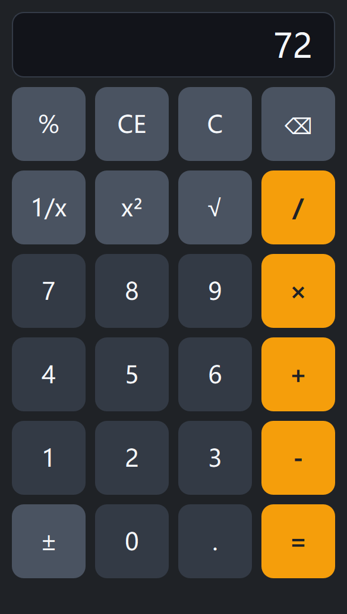

# homework2-计算器（实验1：带键盘事件的计算器）

Qt 应用程序开发课程 实验一 —— 桌面计算器，鼠标点击与键盘输入均可完成计算。



## 界面美化（第五次提交）

- **样式表（QSS）**：按三组统一配色——数字键 `#333a45`、功能键 `#4a5361`、运算符与等号 `#f59e0b`（橙色）；
  按钮统一圆角 10px、字号 20px、最小高度 42px，并带 hover / pressed 反馈
- **显示区**：深色底 + 28px 大字右对齐，圆角边框；状态栏与窗口同色，只在有提示时显示文字
- **布局留白**：外层边距由 1px 调整为 10px、控件间距由 3px 调整为 8px，按钮不再紧贴窗口边缘
- **窗口标题**：由 `MainWindow` 改为「计算器」
- **细节清理**：删除 `.ui` 中空白的菜单栏；平方按钮文字由 `x^2` 改为正式的 `x²`（U+00B2），代码两种写法都识别

## 最后的检查（控件命名与代码结构）

| 检查项 | 结果 |
|---|---|
| 按钮数量与命名（`btnNum0`~`btnNum9`、`btnAdd`、`btnMinus`、`btnMultiply`、`btnDivide`、`btnEqual`、`btnPlus`、`btnSqrt`、`btnSquare`、`btnInverse`、`btnPercentage`、`btnClear`、`btnClearAll`、`btnDel`、`btnPeriod`） | 24 个，无缺失、无多余 |
| 每个按钮都有处理函数 | 数字键走 `btnNumClicked()`，四则运算走 `btnBinaryOperatorClicked()`，单目运算走 `btnUnaryOperatorClicked()`，其余用 `on_控件名_信号名` 自动连接 |
| 显示区 `display` | 只读、不接收焦点（键盘输入不会被输入框截获） |
| 每个按钮单独点击 | 显示均正常（无空值 / nan / inf），数字键各自显示自己的数字 |
| 全部按钮连点两轮后再计算 `7 + 8 =` | 得到 15 |
| 无用代码 | 已删除未使用的成员 `statusMsgLabel` 与其头文件包含 |

## 键盘按键对照表

| 键盘 | 功能 | 键盘 | 功能 |
|---|---|---|---|
| `0`~`9`（主键盘/小键盘） | 数字输入 | `Backspace` | 退格 ⌫ |
| `.` 或 `,` | 小数点 | `Delete` | 相当于 `C`（只清当前输入） |
| `+` `-` `*` `x` `/` | 四则运算（`*` `x` 都表示乘） | `Esc` | 相当于 `CE`（清空整个计算） |
| `Enter` `Return` `=` | 等于 | `%` | 百分号 |
| `@` | 开平方 `√` | `q` | 平方 `x²` |
| `r` | 倒数 `1/x` | `F9` | 正负号 `±` |

鼠标与键盘调用的是同一套处理函数，因此两种输入方式的结果完全一致，也可以混合使用。

## 已实现功能

**运算**

- 四则运算 `+` `-` `×` `/`，含优先级：`1 + 2 × 3 =` 得到 `7`
- 连续运算与结果复用：`1 + 2 + 3 =` 得到 `6`；`2 + 3 =` 后接着 `× 4 =` 得到 `20`
- 单目运算：`±` 正负号、`√` 开平方、`x²` 平方、`1/x` 倒数、`%` 百分号
  （`%` 与常用计算器一致：`50 + 10 % =` 得到 `55`，`100 + 10 % =` 得到 `110`）

**输入与编辑（鼠标 + 键盘）**

- 数字 `0~9`，自动去掉前导零；超过 16 位有效数字后忽略多余按键
- 小数点 `.`：同一个操作数内只允许一个小数点，重复按被忽略
- 退格 `⌫`、`C`（只清当前输入的数）、`CE`（清空整个计算）

**异常与边界**

- 除数为 0、对 0 求倒数、对负数开平方：显示提示信息并进入错误状态，下一次输入自动清零
- 连续运算符（`8 + × 2 =` → 16）：新运算符自动替换旧运算符
- 末尾悬挂运算符（`1 + 2 × =` → 3、`1 + =` → 1）：按 `=` 时丢弃没有第二个操作数的运算符
- 计算结果后继续输入、退格到空、清除后重新计算、鼠标与键盘混合输入，行为与重新输入一致

## 边界与异常处理记录（第四次提交）

| 测试输入 | 原程序现象 | 原因分析 | 修改方法 | 修改后结果 |
|---|---|---|---|---|
| `1 ÷ 3 × 3 =`（连续运算） | 显示 `0.999999999999` | 中间结果入栈时被格式化成 12 位有效数字，再次参与运算时精度已丢失 | 运算链内部改用 `storeNumber()`（17 位有效数字）保存，只在显示时用 `formatNumber()`（12 位）格式化 | 显示 `1` |
| `1 ÷ 3 = × 3 =`（结果复用） | 显示 `0.999999999999` | 同上：`=` 的结果也被截断 | 同上 | 显示 `1` |
| `1 + 2 × =`（末尾悬挂运算符） | 显示 `2` | 按 `=` 时把没有第二个操作数的 `×` 当成有效运算符，用 `1 × 2` 计算 | 结算前判断运算符个数是否 ≥ 操作数个数，是则丢弃末尾悬挂运算符 | 显示 `3` |
| 连续输入 17 位数字 | 显示 17 位，但参与运算的数值与显示不符 | 超过 double 精度后无法精确表示 | 输入满 16 位有效数字后忽略多余按键 | 显示 `1234567890123456` |

其余边界：除零提示后继续输入（`5 ÷ 0 =` 提示后按 `7` → 7）、连续小数点（`1.2.3` → 1.23）、前导零（`000` → 0）、
退格到空（`12 + 34 ⌫ ⌫` → 0，接 `=` → 12）、`C` 与 `CE` 的区别（`1+2C3=` → 4，`1+2E3=` → 3）、
连按运算符、单目运算作用于 0 与负数、优先级组合、鼠标与键盘混合输入。

## 关键实现说明

- 状态：`operand`（当前输入/显示的数值串）+ `operands`（操作数栈）+ `opcodes`（运算符栈），
  配合 `operandEntered`、`hasResult`、`errorState`、`typingDigits` 四个状态位描述整个计算过程
- 精度：`storeNumber()`（17 位有效数字）用于继续运算，`formatNumber()`（12 位）只用于显示；
  逐位输入时显示原样内容，避免出现 `0.1+0.2` 或 `1÷3×3` 的浮点误差
- `calculation(bool *ok)`：结算栈顶的一次二元运算，通过 `ok` 告诉调用方是否真的算过，避免把显示刷成 0
- `priority(opcode)`：`×` `/` 优先级高于 `+` `-`；按运算符时先把栈顶优先级不低于新运算符的运算结算掉
- `keyPressEvent()`：键盘按键翻译成与鼠标相同的调用（`appendDigit()` / `applyBinaryOperator()` /
  `applyUnary()` / `on_btnEqual_clicked()`），两种输入方式共用一套逻辑
- 运算符文字取自按钮 `text()`，与 `.ui` 保持一致：加法键是 `btnAdd`，`×` 为 U+00D7，`±` 键是 `btnPlus`

## 编译与运行

需要 Qt 6（开发环境：Qt 6.11.2 MinGW 64-bit）。

```bash
cmake -S . -B build -G Ninja -DCMAKE_BUILD_TYPE=Debug -DCMAKE_PREFIX_PATH=<Qt安装目录>/6.11.2/mingw_64
cmake --build build
./build/Lab1.exe
```

也可以直接用 Qt Creator 打开 `CMakeLists.txt` 后运行。

## 测试记录

自动化测试（用代码模拟点击按钮 / 发送按键事件，离屏运行），共 110 项检查：

| 测试套件 | 检查项 | 结果 |
|---|---|---|
| 最后检查（命名 / 界面 / 冒烟） | 21 | 全部通过 |
| 边界与异常输入 | 37 | 全部通过 |
| 键盘事件 | 19 | 全部通过 |
| 鼠标点击 | 33 | 全部通过 |

### 边界与异常用例（37 条）

- 精度：`1/3*3=`→1、`2/3*3=`→2、`1/3=*3=`→1、`0.1+0.2=`→0.3
- 悬挂运算符：`1+2*=`→3、`1+=`→1、`1+2+=`→3、`1+2*3+=`→7
- 超长输入：17 位数字 → 前 16 位生效
- 除零：`5/0=+2=`→2、`6/0*22`→22、`1+6/0=`→除数不能为0
- 前导零与小数点：`000`→0、`...`→0.、`1..5`→1.5、`0.5+0.5=`→1
- 结果后继续输入：`2+3=.`→0.、`2+3=<`→0、`2+3=+3=`→8、`2+3=*3=`→15、`1+2=4=`→4
- 退格：`123<<<`→0、`12+34<<`→0、`12+3<=`→12
- 清除：`1+2C3=`→4、`1+2E3=`→3
- 单目运算边界：`9±√+4=`→4、`0x²`→0、`0√`→0、`5±±`→5、`100+10%=`→110、
  `3-5=√`→负数不能开平方、`3-5=x²`→4
- 优先级：`8/2/2=`→2、`2+3*4-6/2=`→11、`8+*2=`→16
- 混合输入：键盘 `1` → 键盘 `+` → 键盘 `5` → 退格 → 键盘 `2` → 鼠标 `=` →3

### 键盘用例（19 条）

键盘四则运算、小键盘输入、键盘下的优先级、小数与退格、Delete/Esc、单目快捷键（`50+10%`、`9@`、`7q`、`4r`、`5F9`）、
键盘除零、鼠标+键盘混合输入、鼠标与键盘结果一致性、显示区焦点检查。

### 鼠标用例（33 条）

四则运算、小数与精度、优先级、连续运算、结果复用、运算符替换、输入异常、清除、除零、
单目运算、百分号、非法单目、结果后继续输入。

### 最后检查用例（21 条）

按钮数量与命名核对（无缺失 / 无多余）、显示区只读与不抢焦点、样式表已应用、窗口标题、
无空白菜单栏、10 个数字键各自点击后显示对应数字、其余按钮单击显示正常、
全部按钮连点两轮后仍能正确计算。
